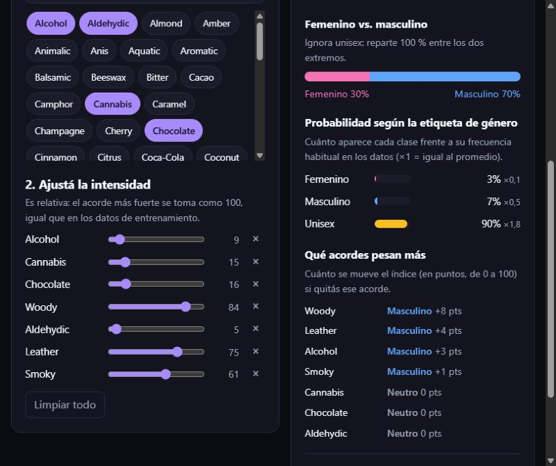
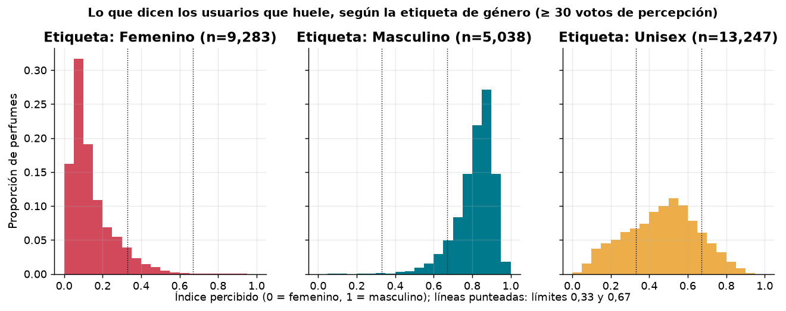
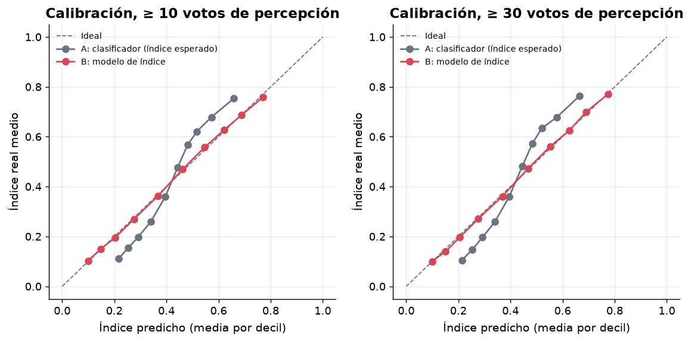
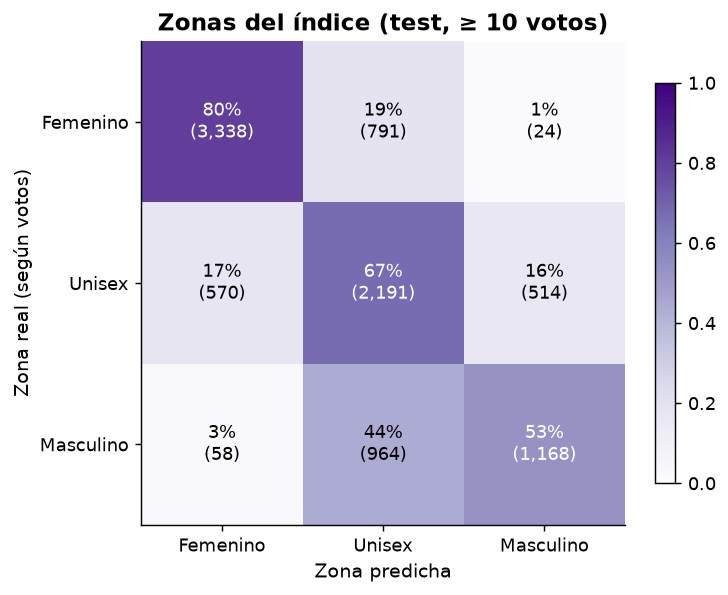
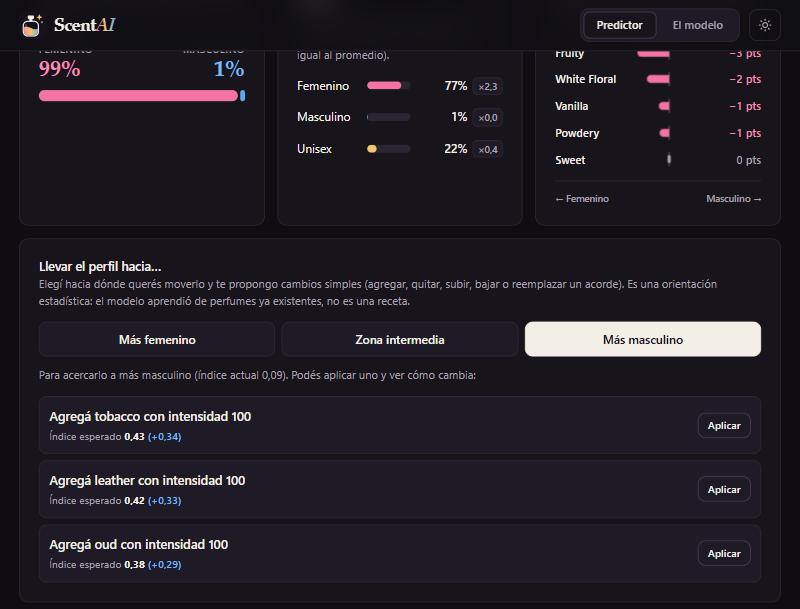

<p align="center"></p>

# ScentAI · ¿Hacia qué lado del espectro cae tu perfume?

Herramienta de apoyo para **perfumistas**: se cargan los **acordes** de un perfume (con su intensidad) y un modelo de Machine Learning ubica el perfil en un **espectro femenino ↔ masculino**, *antes* de pedir la primera muestra a la esenciera. La idea es ahorrar idas y vueltas de muestras que terminan con un carácter distinto al buscado.




**Contenido**

1. [Elección del dataset, variable a predecir y problema a resolver](#1-elección-del-dataset-variable-a-predecir-y-problema-a-resolver)
2. [ETL: limpieza y transformación del dataset](#2-etl-limpieza-y-transformación-del-dataset)
3. [Selección y entrenamiento del modelo](#3-selección-y-entrenamiento-del-modelo)
4. [Modelo terminado, demo y uso](#4-modelo-terminado-demo-y-uso)

> **Inicio rápido (no hace falta el dataset ni entrenar):**
>
> - **Con Python:** `git clone <url-del-repo>` → doble clic en `run.bat` (Windows) o `./run.sh` (Linux/Mac) → abrir <http://localhost:8000>.
> - **Con Docker:** `docker build -t scentai .` → `docker run --rm -p 8000:8000 scentai` → abrir <http://localhost:8000> ([paso a paso](#opción-b-con-docker-paso-a-paso)).
>
> También hay [`MODEL_CARD.md`](MODEL_CARD.md) con usos previstos, límites y sesgos, y [`GUIA_EN_CRIOLLO.md`](GUIA_EN_CRIOLLO.md): una explicación completa, sin tecnicismos, de los conceptos, cada archivo y cada resultado.

---

## 1. Elección del dataset, variable a predecir y problema a resolver

### El problema
Al desarrollar un perfume, el perfumista define un perfil olfativo (qué acordes y con qué peso) y lo encarga a una esenciera. Recién con la muestra física se descubre si el resultado "se lee" femenino, masculino o intermedio; si no era lo buscado, hay que reformular y pedir otra muestra. **Anticipar esa tendencia** reduce iteraciones, tiempo y costo.

- **Entrada:** los **acordes** del perfume y su **intensidad relativa** (0–100).
- **Salida principal:** un **índice de masculinidad percibida** entre 0 (femenino) y 1 (masculino), con tres zonas: femenino (< 0,33), unisex (0,33–0,67) y masculino (> 0,67).
- **Salida complementaria:** las probabilidades de la **etiqueta `gender`** (femenino / masculino / unisex), la lectura *femenino vs. masculino* y cuánto se aparta cada clase de su frecuencia habitual.

### El dataset
Dataset de Kaggle con datos extraídos de **Fragrantica**: **131.930 perfumes y 59 columnas** (marca, año, votos, acordes, notas de salida/corazón/fondo, descripción, votos de percepción de género, etc.). Se eligió porque:

- Tiene la etiqueta `gender` y los acordes con intensidad en el mismo registro.
- Tiene volumen suficiente (>120 mil perfumes únicos) para entrenar modelos no lineales.
- Los acordes vienen cuantificados (`woody:100|sweet:65|...`), justo lo que un perfumista maneja al hacer el pedido.
- Trae los votos `perceived_*` (cuántos usuarios perciben el perfume como femenino, tendiente a femenino, unisex, tendiente a masculino o masculino), una señal de **cómo huele** además de **cómo lo etiqueta la marca**.

Formato de `accords`: `citrus:100|fresh spicy:47|green:41|sweet:33|...`. Fragrantica muestra a lo sumo los **8 acordes principales** y la intensidad es **relativa**: el acorde dominante vale siempre 100 (se verifica en el EDA: 100 % de los perfumes).

### ¿Por qué no solo predecir la etiqueta `gender`?
La primera versión del análisis predecía la etiqueta. Al probar con perfiles claramente "masculinos" para un perfumista (cuero, madera, humo) el clasificador respondía **unisex con ~90 % de probabilidad**. Se investigó si era un problema de desbalance de clases y **no lo es**:

- Balancear las clases (pesos y *undersampling*, sección 3.2) **empeora** las métricas, y con clases balanceadas ese mismo perfil seguía dando 83 % unisex.
- La causa es la propia etiqueta: "unisex" es una **categoría difusa**. Entre los perfumes etiquetados *unisex* con ≥ 30 votos de percepción, el índice percibido cae en la zona **masculina en el 14,1 %**, en la **femenina en el 24,9 %** y en la **intermedia en el 61,0 %**.



La etiqueta *femenino* y la *masculina* se corresponden bien con la percepción (picos claros cerca de 0,1 y 0,85), pero *unisex* es una nube ancha centrada en 0,5. Un clasificador que reproduce esa etiqueta aprende que "unisex" es la respuesta segura. **Decisión:** el modelo principal predice una **posición en el espectro** (índice construido con los votos de percepción) y el clasificador de la etiqueta queda como complemento.

### Acordes vs. notas: ¿son redundantes? ¿qué conoce el perfumista de antemano?
| Pregunta | Respuesta |
|---|---|
| ¿Las notas y los acordes son lo mismo? | **No, pero están muy relacionados.** Los acordes son la lectura global del perfume (p. ej. *woody*, *fresh spicy*); las notas son los ingredientes concretos (p. ej. *cedro*, *pimienta*). |
| ¿Son redundantes para el modelo? | **Parcialmente.** En un experimento controlado (sección 3.2): **solo acordes → F1 macro 0,598**; **acordes + notas → 0,670**; **solo notas → 0,667**. Las notas aportan información extra (ingredientes específicos como *oud*, *rosa* o *lavanda*). |
| ¿Qué conoce el perfumista *antes* de pedir la primera muestra? | Es razonable asumir que parte del **brief por acordes / familias olfativas**, mientras que las notas exactas dependen de las materias primas que se eligen al formular. **Es una hipótesis de dominio: conviene validarla con un perfumista real.** |

**Decisión:** la entrada son **solo los acordes**. Es la información que se asume disponible en la etapa temprana, y mantiene la herramienta simple. El costo es ~7 puntos de F1 respecto de usar también notas; queda como **mejora futura**.

### Limitaciones que hay que conocer
- Los acordes de Fragrantica son **votos de la comunidad sobre perfumes ya lanzados**, no una fórmula: el modelo aprende cómo se perciben o comercializan los perfiles existentes. Es una **orientación estadística**, no una garantía.
- **Los votos de percepción tampoco están libres de sesgo:** quienes votan ven antes la etiqueta de la marca. El índice mejora la señal, pero no la vuelve neutral.
- El modelo **reproduce convenciones culturales** sobre qué es "femenino" o "masculino"; no las juzga.

---

## 2. ETL: limpieza y transformación del dataset

Todo es reproducible con `pipeline/01_eda.py` y `pipeline/02_etl.py`. La lógica de parseo vive en un único lugar (`perfume_gender/parsing.py`, `perfume_gender/perception.py`) y la usan tanto el pipeline como la API, para que **entrenamiento y servicio transformen los datos igual**.

### 2.1 Resumen del flujo

| Paso | Decisión | Filas |
|---|---|---|
| Dataset crudo | — | 131.930 |
| Eliminar perfumes sin `accords` | Sin acordes no hay información para predecir; imputarlos inventaría datos | −2.769 → 129.161 |
| Deduplicar perfiles de acordes idénticos | Evita que el mismo perfil caiga en train y en test (métrica inflada) | −6.206 → **122.955** |
| Partición estratificada 80/20 | Mantiene la proporción de clases en ambos conjuntos | train **98.364** / test **24.591** |
| Calcular el índice de percepción | Solo existe si el perfume tiene ≥ 1 voto de percepción | **100.541** perfumes (train: **80.465**, 81,8 %) |

Columnas usadas: `gender`, `accords` y, **solo para construir el objetivo**, `perceived_*`. Se **descartan como predictores** `name`, `brand`, `description`, ratings, votos y popularidad: la descripción contiene literalmente "for women / for men" (*leakage* directo) y `perceived_*` son votos sobre el propio género.

### 2.2 Variable objetivo (etiqueta) y desbalance


Tras limpiar: **unisex 51,2 %** (62.962), **femenino 33,3 %** (40.936), **masculino 15,5 %** (19.057). Un modelo que siempre dijera *unisex* acierta **51,2 %**: ese es el **baseline**. Por el desbalance se usa **F1 macro** como métrica principal del clasificador.

**¿Balancear?** Se probó *sin pesos*, `class_weight="balanced"` y *undersampling*:

| Estrategia | F1 macro | Exactitud |
|---|---|---|
| **Sin pesos (elegida)** | **0,598** | **0,644** |
| `class_weight="balanced"` | 0,581 | 0,589 |
| Undersampling (36.591 filas) | 0,577 | 0,584 |

Balancear **empeoró** ambas métricas y además distorsiona las probabilidades que ve el usuario; por eso no se balancea.

### 2.3 Acordes: estructura, intensidades y outliers


- **95 % de los perfumes tiene exactamente 8 acordes** (116.782); el resto tiene menos (6.173). Los de menos de 8 **no parecen errores**: son datos válidos con menos votos (mediana de 5 a 8 votos contra 14 en los de 8 acordes). Se **conservan**.
- **Intensidades:** el acorde principal es siempre 100; el resto tiene mediana 50 y mínimo 1. Se normalizan a [0, 1] (valor/100); un acorde ausente vale 0. No hay valores fuera de rango, así que **no se recortan**.


- **Acordes ultra-raros:** de 92 acordes distintos, **20 aparecen en menos de 50 perfumes** (`tennis ball`, `wet plaster`, `brown scotch tape`, `bbq`…). No aportan señal y favorecen el sobreajuste: el vocabulario final es de **72 acordes**.


### 2.4 Votos: ¿la media es alta? ¿conviene filtrar?


Hay dos tipos de votos y en ambos **la media engaña** por la cola larga:

| Votos | Media | Mediana | Percentil 75 | Percentil 90 |
|---|---|---|---|---|
| Rating (`vote_count`) | 172,5 | 13 | 69 | 283 |
| Percepción de género (`perceived_*`) | 64,5 | 5 | 24 | 98 |

El perfume típico tiene 5 votos de percepción; unos pocos con miles inflan la media. Un perfume con pocos votos tiene un índice menos confiable (con 1 o 2 votos solo puede tomar unos pocos valores). Se midió cómo tratarlo con una validación **dentro del train** (sin usar el test), evaluando en perfumes con ≥ 30 votos de percepción (`experiments/vote_weights.py`):

| Mínimo de votos para entrenar | Filas de entrenamiento | Error medio | Spearman |
|---|---|---|---|
| 1 (todo) | 64.372 | 0,1237 | 0,824 |
| 5 | 41.686 | 0,1221 | 0,827 |
| 10 | 31.363 | 0,1226 | 0,827 |
| 30 | 17.699 | 0,1217 | 0,827 |
| 100 | 7.804 | 0,1247 | 0,817 |

Filtrar por votos **no mejora**: del mínimo 1 al 30 el error casi no se mueve y a partir de 50 empeora, porque se pierden datos. Alternativa: **no descartar y ponderar** cada perfume según sus votos (promedio de 3 particiones):

| Esquema | Error medio | Spearman |
|---|---|---|
| Sin filtro ni pesos | 0,1233 | 0,825 |
| Filtro mínimo 5, sin pesos | 0,1223 | 0,827 |
| Pesos `min(votos, 30)` | 0,1215 | 0,828 |
| **Pesos √votos, con tope 100 (elegido)** | **0,1215** | **0,829** |

La mejora de ponderar frente a no hacer nada es chica (≈ 1,5 % del error); se elige √votos con tope porque usa todas las filas con índice, rinde igual o mejor que el resto y no requiere un umbral arbitrario. **Importante:** el índice solo existe para perfumes con ≥ 1 voto de percepción, es decir, **80.465 filas (81,8 %) del train**; las demás no se usan para el modelo de índice (sí para el clasificador).

### 2.5 Duplicados y etiquetas contradictorias
Había **6.206 filas con un perfil de acordes idéntico a otro** (típicamente versiones o concentraciones de un mismo perfume) y **727 perfiles con géneros distintos** (5.741 filas). Si no se tratan, el mismo perfil puede quedar en train y en test y el modelo "memoriza". **Decisión:** un registro por perfil; si hay conflicto de etiqueta se conserva la que tiene más respaldo (suma de `vote_count + 1`).

### 2.6 El índice de masculinidad percibida
Cada voto de percepción tiene un peso en el espectro:

| Voto | Peso |
|---|---|
| Femenino | 0 |
| Tiende a femenino | 0,25 |
| Unisex | 0,5 |
| Tiende a masculino | 0,75 |
| Masculino | 1 |

`índice = Σ(peso · votos) / Σ votos`. Las zonas usan los límites **0,33 y 0,67**.

### 2.7 ¿Qué distingue a cada lado?


Los femeninos se caracterizan por **floral, white floral, fruity, sweet, rose, powdery y vanilla**; los masculinos por **aromatic, fresh spicy, woody, warm spicy, citrus, amber, lavender y leather**. Hay estructura clara en los datos, por eso el problema es viable.


### 2.8 Transformación final
Cada perfume se convierte en un **vector de 72 posiciones** (`models/accords_vocab.json`) con la intensidad/100 o 0 si el acorde no está. La API aplica la misma transformación y **reescala la entrada para que el acorde más fuerte valga 100**, igual que en los datos.

---

## 3. Selección y entrenamiento del modelo

### 3.1 Protocolo (para no engañarse con la métrica)
- **Test (24.591 perfumes) separado desde el ETL y usado una sola vez**, al final.
- La **selección y el ajuste se hacen sin el test**: validación cruzada de 5 folds sobre el train, o validación interna del train.
- Perfiles idénticos deduplicados antes de partir, para no filtrar información entre train y test.

### 3.2 Clasificador de la etiqueta `gender` (complemento)

**Features: acordes vs. notas.** Con un modelo rápido y validación interna:


| Variables | F1 macro | Exactitud |
|---|---|---|
| **Solo acordes (elegido por caso de uso)** | 0,598 | 0,644 |
| Acordes + notas (top 300 notas) | 0,670 | 0,701 |
| Solo notas | 0,667 | 0,698 |

**Comparación de modelos** (CV de 5 folds sobre train):


| Modelo | F1 macro (media ± desvío) | Exactitud |
|---|---|---|
| Baseline (clase mayoritaria) | 0,226 | 0,512 |
| Regresión logística | 0,572 ± 0,002 | 0,634 |
| Random Forest | 0,572 ± 0,003 | 0,643 |
| SVM RBF (submuestra de 20.000 filas*) | 0,559 ± 0,006 | 0,633 |
| Gradient Boosting (HGB) | 0,598 ± 0,002 | 0,646 |
| MLP (red neuronal) | 0,600 ± 0,004 | 0,646 |
| **Gradient Boosting (HGB) ajustado** | **0,600 ± 0,002** | **0,647** |

\* La SVM RBF es O(n²) y no escala a 98 mil filas; tampoco entrega probabilidades de forma nativa.

**Ganador:** Gradient Boosting (`HistGradientBoostingClassifier`) ajustado con `RandomizedSearchCV` (`learning_rate=0.08`, `max_leaf_nodes=63`, `min_samples_leaf=20`, `max_iter=300`). El MLP queda empatado dentro del desvío; se prefiere HGB por estable y liviano. Los modelos sofisticados apenas superan a la regresión logística (≈ +3 puntos de F1): el techo lo pone la **información disponible**, no el algoritmo.

**Resultado en test:** exactitud **64,7 %** (baseline 51,2 %), F1 macro **0,599**.

| Clase | Precisión | Recall | F1 | Perfumes |
|---|---|---|---|---|
| Femenino | 65,5 % | 66,5 % | 0,660 | 8.187 |
| Masculino | 58,5 % | 36,6 % | 0,451 | 3.811 |
| Unisex | 65,3 % | 72,0 % | 0,685 | 12.593 |


- Casi **nunca invierte el género**: solo el 2 % de los femeninos se predicen masculinos y el 5 % de los masculinos como femeninos. Los errores caen casi todos en "unisex".
- **Los masculinos son la clase más difícil** (recall 37 %): el clasificador los manda a "unisex". Es el síntoma que motivó el modelo de índice.

**Calibración y robustez.** Las probabilidades están bien calibradas (error esperado ≈ 0,4 % para femenino y masculino y 1,0 % para unisex):


Con marcas que el modelo nunca vio el F1 macro es **0,598** (contra 0,599 con partición aleatoria). Por cantidad de votos de rating (F1 macro): 0–4 votos **0,570** · 5–19 **0,587** · 20–99 **0,624** · 100+ **0,616**. Acordes que más mueven la predicción:


### 3.3 Modelo principal: índice de masculinidad percibida

- **Objetivo:** el índice 0–1 de la sección 2.6. Los votos `perceived_*` se usan **solo como objetivo, nunca como predictores**.
- **Modelo:** `HistGradientBoostingRegressor` con hiperparámetros fijos (`learning_rate=0.08`, `max_leaf_nodes=31`, `min_samples_leaf=40`, `max_iter=300`, parada temprana); **no se ajustan con el test**.
- **Entrenamiento:** 80.465 perfumes de train con ≥ 1 voto de percepción, con peso √min(votos, 100).
- **Validación cruzada** (5 folds, sobre perfumes con ≥ 10 votos): error medio **0,126 ± 0,001**, Spearman **0,809 ± 0,004**.

**Comparación contra el clasificador** en el test, convirtiendo el clasificador a un índice esperado (A) y comparándolo con el regresor (B). Se muestran perfumes con votos de percepción suficientes (≥ 10 es la referencia):

| Votos mínimos | Perfumes test | Error A → B | Spearman A → B | F1 por zonas A → B |
|---|---|---|---|---|
| **≥ 10** | 9.618 | 0,157 → **0,126** (−20,1 %) | 0,800 → **0,810** | 0,613 → **0,676** |
| ≥ 30 | 5.430 | 0,156 → 0,122 (−21,9 %) | 0,811 → 0,824 | 0,616 → 0,689 |
| ≥ 100 | 2.370 | 0,160 → 0,125 (−22,2 %) | 0,821 → 0,832 | 0,610 → 0,684 |

(El F1 por zonas de A usa la clase más probable del clasificador; usar un umbral sobre su índice esperado da 0,537, aún peor.)



**Lectura honesta:**
- **El regresor corrige la escala.** El clasificador, convertido a índice, queda comprimido hacia el centro y no llega a los extremos; el regresor sigue la diagonal ideal.
- **No mejora el orden entre perfumes** (Spearman casi igual, +0,01): los acordes dan la misma información; lo que cambia es dónde se ubica cada perfume en la escala.
- **Sesgo a favor de B en esta comparación:** se mide contra el índice con el que B se entrenó. Para predecir la etiqueta `gender`, el clasificador sigue siendo el indicado.

**Zonas del índice** (test, ≥ 10 votos):



El regresor acierta el 80 % de los femeninos, el 67 % de los intermedios y el **53 % de los masculinos**: el 44 % de los perfumes percibidos como masculinos queda en la zona intermedia. Mejor que el clasificador, pero los acordes solos no alcanzan para separarlos del todo.

**Caso de prueba** (perfil aportado por un usuario: *alcohol 9, cannabis 15, chocolate 16, woody 84, aldehydic 5, leather 75, smoky 61*):

| Modelo | Resultado |
|---|---|
| Clasificador de la etiqueta | femenino 3 % · masculino 7 % · **unisex 90 %** (índice esperado 0,479, en el centro) |
| **Índice** | **0,717 → zona masculina** (lectura femenino vs. masculino: 30 % / 70 %) |

### 3.4 Cómo se usan juntos
La app muestra el **índice y su zona** como resultado principal, y agrega del clasificador: la **lectura femenino vs. masculino** (ignora unisex: `p_masculino / (p_masculino + p_femenino)`) y la **frecuencia base** (probabilidad ÷ frecuencia de la clase en train; ×1 = igual al promedio). En el caso de prueba, el masculino sale ×0,5 y unisex ×1,8: unisex es la respuesta "segura" del clasificador, no un hallazgo.

---

## 4. Modelo terminado, demo y uso

### 4.1 Qué se entrega
- **Modelos:** `models/index_model.joblib` (≈ 0,5 MB) y `models/model.joblib` (≈ 1 MB), con `models/accords_vocab.json` y `models/metadata.json`.
- **Backend:** API REST con **FastAPI** (`app/backend`).
- **Frontend:** página estática (HTML/CSS/JS, sin CDN: funciona sin internet) servida por el mismo backend (`app/frontend`). Tema oscuro y claro (sigue al sistema), diseño adaptable a celular, navegación por teclado y logo propio (`app/frontend/assets`).
- **Pipeline reproducible**, **tests** y **CI** (`.github/workflows/tests.yml`).
- **Dockerfile** (imagen de ≈ 570 MB que incluye código, modelos y reportes; probada con Docker 29.7) y **ficha del modelo** ([`MODEL_CARD.md`](MODEL_CARD.md)).

### 4.2 Instalación y ejecución (usar la app)
Hay dos caminos equivalentes. Elegí **uno**: el A si tenés Python, el B si preferís no instalar nada más que Docker.

#### Opción A: con Python (`run.bat` / `run.sh`)
Requisito: **Python 3.14** (versión con la que se probó todo el proyecto).

1. Clonar el repositorio y entrar a la carpeta: `git clone <url-del-repo>` y `cd` a la carpeta.
2. **Windows:** doble clic en `run.bat`, o desde una terminal:
   ```bash
   run.bat
   ```
   **Linux / Mac:**
   ```bash
   ./run.sh
   ```
   La primera vez crea `.venv` e instala `requirements-app.txt` (solo lo necesario para usar la app).
3. Abrir **<http://localhost:8000>**. La documentación interactiva de la API queda en <http://localhost:8000/docs>.
4. Para detener: `Ctrl+C` en la terminal.

Manualmente, sin los scripts:
```bash
python -m venv .venv
.venv\Scripts\activate            # Linux/Mac: source .venv/bin/activate
pip install -r requirements-app.txt
python -m uvicorn app.backend.main:app --port 8000
```

#### Opción B: con Docker (paso a paso)
Docker empaqueta la app con su entorno exacto (Python 3.14 y las librerías en las versiones fijadas), así que **no hace falta instalar Python** ni preparar nada. La imagen incluye el código, los modelos y los reportes, pero **no** el dataset ni el pipeline de entrenamiento (ver `.dockerignore`).

1. **Instalar Docker.** Docker Desktop en Windows o Mac, Docker Engine en Linux (<https://docs.docker.com/get-docker/>). Abrí Docker Desktop y esperá a que indique que el motor está corriendo.
2. **Verificar que funciona:**
   ```bash
   docker --version
   docker info
   ```
   Si `docker info` falla con *"failed to connect to the docker API"* o *"Cannot connect to the Docker daemon"*, Docker Desktop no está abierto: abrilo y reintentá.
3. **Clonar el repositorio y entrar a la carpeta** (la que contiene el `Dockerfile`):
   ```bash
   git clone <url-del-repo>
   cd <carpeta-del-repo>
   ```
4. **Construir la imagen** (solo la primera vez, o cuando cambie el código o los modelos; tarda unos minutos porque descarga Python y las librerías, y la imagen pesa unos 570 MB):
   ```bash
   docker build -t scentai .
   ```
5. **Ejecutar el contenedor:**
   ```bash
   docker run --rm -p 8000:8000 scentai
   ```
   Cuando aparezca `Uvicorn running on http://0.0.0.0:8000`, la app está lista. (`-p 8000:8000` conecta el puerto 8000 de tu máquina con el del contenedor; `--rm` borra el contenedor al detenerlo.)
6. **Abrir <http://localhost:8000>** en el navegador. La documentación de la API queda en <http://localhost:8000/docs>.
7. **Detener:** `Ctrl+C` en esa terminal.

Variantes útiles:

| Quiero… | Comando |
|---|---|
| Correrlo en segundo plano | `docker run -d --rm --name scentai -p 8000:8000 scentai` |
| Ver los mensajes del servidor | `docker logs scentai` |
| Detener el contenedor en segundo plano | `docker stop scentai` |
| Usar otro puerto (p. ej. 8080) | `docker run --rm -p 8080:8000 scentai` y abrir <http://localhost:8080> |
| Comprobar que responde | `curl http://localhost:8000/api/health` (debe devolver `{"status":"ok"}`) |
| Borrar la imagen y recuperar espacio | `docker rmi scentai` |

Problemas frecuentes:
- **`port is already allocated` / `address already in use`:** el puerto 8000 está ocupado (por ejemplo, por `run.bat`). Detené el otro proceso o usá otro puerto como en la tabla.
- **Cambié el código o reentrené los modelos y no veo cambios:** hay que volver a construir la imagen (paso 4); el contenedor usa una copia de los archivos tomada al construir.
- **Quiero reentrenar los modelos:** se hace con el entorno Python completo (sección 4.5), no dentro de esta imagen.

### 4.3 Cómo usar la demo
1. En **Predictor**, empezá con uno de los **ejemplos** o buscá y tocá los acordes (hasta 8).
2. Ajustá la **intensidad** con los controles (es relativa: el acorde más fuerte se toma como 100).
3. A la derecha (o arriba, en el celular) aparece la **posición en el espectro**: el índice y una barra con tres zonas. En el celular, una **barra flotante** mantiene a la vista el resultado mientras editás.
4. Debajo, la **lectura detallada**: la **lectura femenino vs. masculino**, las **probabilidades por etiqueta con su frecuencia base** y **qué acordes pesan más** (cuántos puntos del índice se mueve si se quita cada uno, con barras que apuntan a femenino o a masculino).
5. El botón del sol/luna cambia entre **tema oscuro y claro** (por defecto sigue al sistema y recuerda tu elección).
6. La pestaña **El modelo** muestra las métricas reales leídas de la API: comparación índice vs. clasificador, estudio de votos, comparación de modelos y matriz de confusión.
7. En **"Llevar el perfil hacia…"** elegí un objetivo (más femenino, zona intermedia o más masculino): la app propone hasta 3 cambios simples y un botón **Aplicar** para probarlos.



#### Cómo funcionan las sugerencias
Con el modelo de índice se prueban **cambios simples de a uno** sobre el perfil actual y se devuelven los que más lo acercan al objetivo, sin repetir acorde:

| Cambio | Qué prueba |
|---|---|
| **Agregar** un acorde | Con intensidad 30 %, 60 % o 100 % de la del acorde más fuerte (solo si hay menos de 8 acordes). |
| **Quitar** un acorde | Cada uno de los que hay (si quedan al menos 2). |
| **Subir / bajar** la intensidad | Subir suma el 30 % del acorde más fuerte; bajar la reduce a la mitad. |
| **Reemplazar** un acorde por otro | Solo cuando el perfil ya tiene 8 acordes y no se puede agregar. |

Las intensidades sugeridas están en **la misma escala que cargó el usuario**, para poder aplicarlas tal cual. Como cada cambio mueve el índice en un paso moderado, se puede **aplicar uno y pedir de nuevo** hasta llegar a la zona buscada.

**¿Qué tan bien funcionan?** Se verificó con perfumes reales del test (`experiments/suggestions_check.py`, hasta 300 por caso). Es el índice **esperado por el modelo**, no un cambio real de percepción:

| Zona actual → objetivo | La mejor sugerencia llega a la zona | Mejora media del índice |
|---|---|---|
| Intermedia → masculino | **88,0 %** | 0,241 |
| Intermedia → femenino | **96,0 %** | 0,284 |
| Masculino → femenino | **54,7 %** | 0,401 |
| Femenino → masculino | **9,3 %** | 0,388 |

Lo esperable: acercar un perfil intermedio hacia un extremo es fácil con un solo cambio; cruzar de un extremo al otro (por ejemplo, de femenino a masculino) requiere varios pasos.

> **Es correlación, no causalidad.** El modelo aprendió cómo se perciben perfumes ya existentes; no sabe cómo huele una fórmula. Las sugerencias son ideas para probar, no una receta.

### 4.4 API
`POST /api/predict`
```bash
curl -X POST http://localhost:8000/api/predict -H "Content-Type: application/json" \
  -d '{"accords":[{"name":"woody","intensity":100},{"name":"leather","intensity":75},{"name":"smoky","intensity":60}]}'
```
Respuesta real del modelo incluido:
```json
{
  "index": 0.6836,
  "zone": "male",
  "male_vs_female": {"female": 0.1416, "male": 0.8584},
  "class_probabilities": {"female": 0.0295, "male": 0.1786, "unisex": 0.7919},
  "lift": {"female": 0.089, "male": 1.152, "unisex": 1.546},
  "accords_used": {"woody": 100.0, "leather": 75.0, "smoky": 60.0},
  "influences": [
    {"accord": "woody", "index_effect": 0.0663, "pushes_toward": "male"},
    {"accord": "leather", "index_effect": 0.0385, "pushes_toward": "male"},
    {"accord": "smoky", "index_effect": 0.0067, "pushes_toward": "male"}
  ]
}
```
`POST /api/suggest`
```bash
curl -X POST http://localhost:8000/api/suggest -H "Content-Type: application/json" \n  -d '{"accords":[{"name":"white floral","intensity":100},{"name":"sweet","intensity":75}],"target":"male"}'
```
Devuelve el índice actual, si el objetivo ya se alcanzó y la lista de sugerencias (por ejemplo, `{"action": "add", "accord": "tobacco", "to_intensity": 100, "index_after": ..., "delta": ...}`).

| Endpoint | Descripción |
|---|---|
| `GET /api/health` | Estado del servicio y de los modelos |
| `GET /api/accords` | Vocabulario de acordes válidos y máximo permitido |
| `POST /api/predict` | Índice, zona, lectura masculino/femenino, probabilidades, frecuencia base e influencia de cada acorde (acordes desconocidos o más de 8 → 422) |
| `POST /api/suggest` | Hasta 3 cambios que acercan el índice al objetivo (`target`: `female`, `unisex` o `male`, o `target_index` entre 0 y 1; exactamente uno). Responde `index`, `zone`, `reached` y `suggestions` (`action`, `accord`, `replaces`, `from_intensity`, `to_intensity`, `index_after`, `delta`) |
| `GET /api/model/info` | Metadatos y métricas de ambos modelos (leídos de `models/` y `reports/`) |

### 4.5 Reentrenar desde cero (opcional)
Requiere `pip install -r requirements.txt` (entorno completo) y el dataset en `data/raw/perfumes.csv` (ver `data/raw/README.md`).
```bash
python pipeline/run_all.py
```
Orden: `01_eda.py` (figuras) → `02_etl.py` (limpieza e índice) → `03_experiments.py` (features / desbalance / votos de rating) → `04_train.py` (clasificador) → `05_train_index.py` (modelo de índice) → `06_evaluate.py` (evaluación del clasificador) → `experiments/vote_weights.py` (estudio de votos) → `experiments/suggestions_check.py` (verificación de las sugerencias). Todas las cifras de este README salen de `reports/*.json`; `tests/test_readme_consistency.py` verifica que coincidan. Semilla fija (`42`): los resultados son reproducibles.

### 4.6 Estructura del repositorio
```
├── README.md · MODEL_CARD.md · GUIA_EN_CRIOLLO.md
├── requirements.txt            # entorno completo (app + pipeline + tests)
├── requirements-app.txt        # solo lo necesario para usar la app
├── run.bat / run.sh            # levantar la app con Python (un comando)
├── Dockerfile / .dockerignore  # levantar la app con Docker (ver 4.2, opción B)
├── .github/workflows/          # CI: corre los tests en cada push
├── perfume_gender/             # lógica compartida (parseo, índice, features, predictor)
├── pipeline/                   # EDA → ETL → clasificador → índice → evaluación
├── experiments/                # estudio de pesos por votos y verificación de sugerencias
├── app/{backend,frontend}/     # FastAPI + HTML/CSS/JS (frontend/assets: logo)
├── models/                     # modelos entrenados, vocabulario y metadata
├── reports/                    # métricas en JSON (fuente de las cifras)
├── docs/                       # figuras del README
├── data/raw/                   # aquí va perfumes.csv (no versionado)
└── tests/                      # pytest
```
Tests: `python -m pytest tests -q`.

### 4.7 Limitaciones y próximos pasos
- **Orientación estadística**: se entrenó con acordes votados por usuarios de perfumes ya lanzados, no con fórmulas.
- Los perfumes **masculinos** siguen siendo los más difíciles: el 44 % de los percibidos como masculinos queda en la zona intermedia.
- **Validar con perfumistas reales** que los acordes sean el dato disponible al hacer el pedido; si conocen las notas, un modelo "acordes + notas" subiría ~7 puntos de F1 (clasificador).
- Ideas: combinar **varios cambios a la vez** en las sugerencias (hoy se aplican de a uno y se vuelve a pedir); traducir los acordes al español; actualizar el dataset (hay una versión más reciente en Kaggle, aún no evaluada).

---
*Proyecto de Machine Learning. Datos: Fragrantica (vía Kaggle).*
