# ScentAI · ¿Hacia qué género tiende tu perfume?

Herramienta de apoyo para **perfumistas**: se cargan los **acordes** de un perfume (con su intensidad) y un modelo de Machine Learning estima si el perfil tiende a **femenino, masculino o unisex**, *antes* de pedir la primera muestra a la esenciera. La idea es ahorrar idas y vueltas de muestras que terminan en un género distinto al buscado.

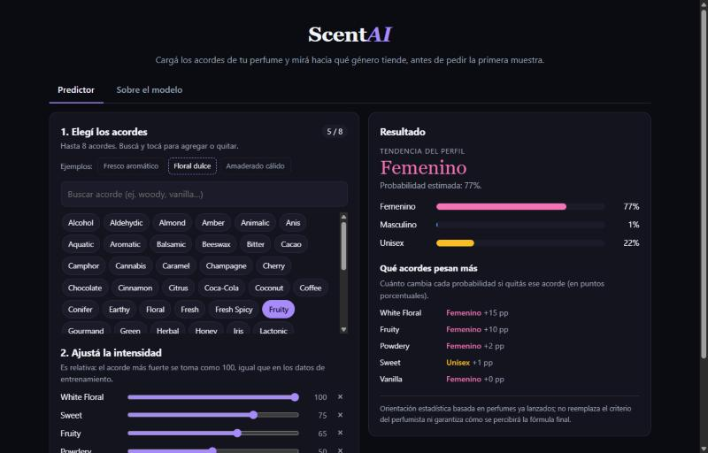

**Contenido**

1. [Elección del dataset, variable a predecir y problema a resolver](#1-elección-del-dataset-variable-a-predecir-y-problema-a-resolver)
2. [ETL: limpieza y transformación del dataset](#2-etl-limpieza-y-transformación-del-dataset)
3. [Selección y entrenamiento del modelo](#3-selección-y-entrenamiento-del-modelo)
4. [Modelo terminado, demo y uso](#4-modelo-terminado-demo-y-uso)

> **Inicio rápido (no hace falta el dataset ni entrenar):**
> `git clone <repo>` → doble clic en `run.bat` (Windows) o `./run.sh` (Linux/Mac) → abrir <http://localhost:8000>.

---

## 1. Elección del dataset, variable a predecir y problema a resolver

### El problema
Al desarrollar un perfume, el perfumista define un perfil olfativo (qué acordes y con qué peso) y lo encarga a una esenciera. Recién con la muestra física se descubre si el resultado "se lee" femenino, masculino o unisex; si no era lo buscado, hay que reformular y pedir otra muestra. **Predecir esa tendencia con anticipación** reduce iteraciones, tiempo y costo.

- **Tipo de problema:** clasificación multiclase supervisada (3 clases).
- **Variable objetivo:** `gender` ∈ {`female`, `male`, `unisex`}.
- **Variables predictoras:** los **acordes** del perfume y su **intensidad** (0–100).
- **Salida útil para el usuario:** no solo la etiqueta, sino las **probabilidades** de cada género y qué acordes empujan el resultado hacia cada lado.

### El dataset
Dataset de Kaggle con datos extraídos de **Fragrantica** (la mayor comunidad de perfumes): **131.930 perfumes y 59 columnas** (marca, año, votos, acordes, notas de salida/corazón/fondo, descripción, etc.). Se eligió porque:

- Tiene la etiqueta `gender` y los acordes con intensidad en el mismo registro.
- Tiene volumen suficiente (>120 mil perfumes únicos) para entrenar modelos no lineales.
- Los acordes vienen cuantificados (`woody:100|sweet:65|...`), justo lo que un perfumista maneja al hacer el pedido.

Formato de la columna `accords`: `citrus:100|fresh spicy:47|green:41|sweet:33|...`. Fragrantica muestra a lo sumo los **8 acordes principales** y la intensidad es **relativa**: el acorde dominante vale siempre 100 (se verifica en el EDA: 100 % de los perfumes).

### Acordes vs. notas: ¿son redundantes? ¿qué conoce el perfumista de antemano?
Esta fue la duda de dominio central y se resolvió con datos **y** con el contexto de uso:

| Pregunta | Respuesta |
|---|---|
| ¿Las notas y los acordes son lo mismo? | **No, pero están muy relacionados.** Los acordes son la lectura global del perfume (p. ej. *woody*, *fresh spicy*); las notas son los ingredientes concretos (p. ej. *cedro*, *pimienta*). Los acordes "resumen" a las notas. |
| ¿Son redundantes para el modelo? | **Parcialmente.** En un experimento controlado (sección 3) **solo acordes → F1 macro 0,598**; **acordes + notas → 0,670**; **solo notas → 0,667**. Las notas aportan información extra (ingredientes específicos como *oud*, *rosa* o *lavanda*) y casi todo lo que aportan los acordes ya está contenido en ellas. |
| ¿Qué conoce el perfumista *antes* de pedir la primera muestra? | Es razonable asumir que parte del **brief por acordes / familias olfativas** (lo que se le pide a la esenciera), mientras que las notas exactas dependen de las materias primas que recién se eligen al formular. **Esta es una hipótesis de dominio: conviene validarla con un perfumista real.** |

**Decisión:** el modelo usa **solo acordes con intensidad**. Es la información que se asume disponible en la etapa temprana del proceso, evita que el usuario deba inventar notas que todavía no definió, y mantiene la herramienta simple (un solo tipo de entrada). El costo es una pérdida de ~7 puntos de F1 respecto de usar también notas; se documenta como **posible mejora futura** (modelo alternativo "acordes + notas" para quien ya tenga la pirámide olfativa definida).

### Limitaciones que hay que conocer
- Los acordes de Fragrantica son **votos de la comunidad sobre perfumes ya lanzados**, no una fórmula. El modelo aprende "qué perfiles de acordes suelen percibirse o comercializarse como femeninos, masculinos o unisex". Es una **orientación estadística**, no una garantía de cómo se percibirá la fórmula final.
- El género de un perfume también depende de marketing, packaging y marca, variables que no se observan aquí.
- **Unisex es una clase intrínsecamente difusa** (es "el resto"): se confunde con las otras dos, como se ve en la sección 3.

---

## 2. ETL: limpieza y transformación del dataset

Todo el proceso es reproducible con `pipeline/01_eda.py` y `pipeline/02_etl.py`; la lógica de parseo vive en un único lugar (`perfume_gender/parsing.py`) y la usan tanto el pipeline como la API, para que **entrenamiento y servicio transformen los datos exactamente igual**.

### 2.1 Resumen del flujo

| Paso | Decisión | Filas |
|---|---|---|
| Dataset crudo | — | 131.930 |
| Eliminar perfumes sin `accords` | Sin acordes no hay información para predecir; imputarlos inventaría datos | −2.769 → 129.161 |
| Deduplicar perfiles de acordes idénticos | Evita que el mismo perfil caiga en train y en test (métrica inflada) | −6.206 → **122.955** |
| Partición estratificada 80/20 | Mantiene la proporción de clases en ambos conjuntos | train **98.364** / test **24.591** |

Columnas usadas: `gender`, `accords` (y `vote_count`, `brand`, `notes_*` solo para análisis/experimentos). **Se descartan** `name`, `brand`, `description`, `perceived_*`, ratings, votos y popularidad como predictores: la descripción contiene literalmente "for women / for men" (*leakage* directo) y `perceived_*` son votos del propio género.

### 2.2 Variable objetivo y desbalance

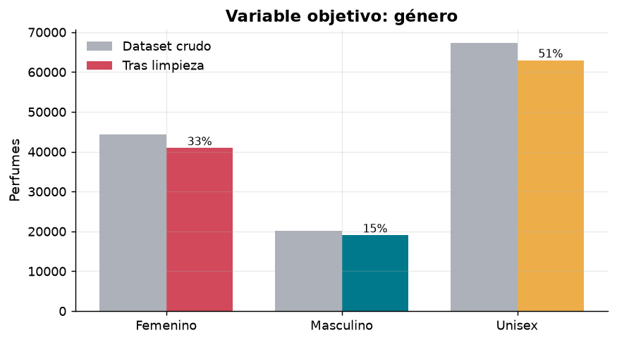

Tras limpiar: **unisex 51,2 %** (62.962), **femenino 33,3 %** (40.936), **masculino 15,5 %** (19.057). Un modelo "tonto" que siempre diga *unisex* acierta **51,2 %**: ese es el **baseline** a superar. Por el desbalance se usa **F1 macro** como métrica principal (promedia las 3 clases por igual) además de la exactitud.

**¿Balancear?** Se probó *sin pesos*, `class_weight="balanced"` y *undersampling*:

| Estrategia | F1 macro | Exactitud |
|---|---|---|
| **Sin pesos (elegida)** | **0,598** | **0,644** |
| `class_weight="balanced"` | 0,581 | 0,589 |
| Undersampling (36.591 filas) | 0,577 | 0,584 |

Balancear **empeoró** ambas métricas y además distorsiona las probabilidades que ve el usuario; por eso no se balancea.

### 2.3 Acordes: estructura, intensidades y outliers

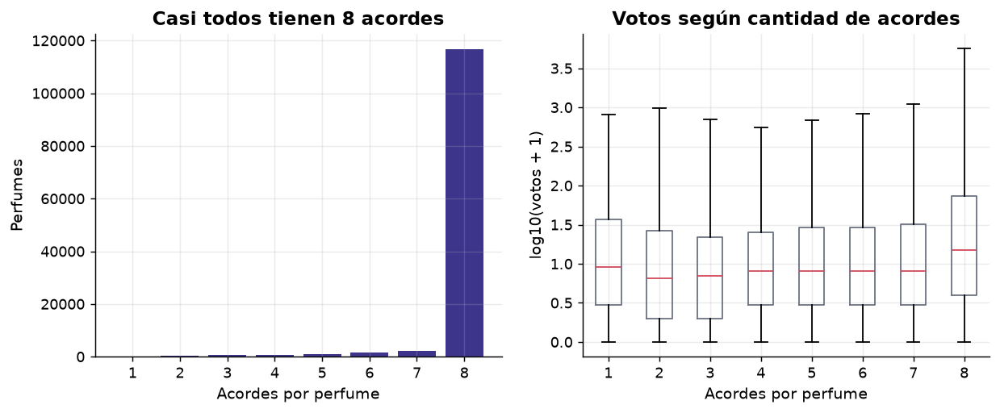

- **95 % de los perfumes tiene exactamente 8 acordes** (116.782); el resto tiene menos (6.173). Los perfumes con menos de 8 acordes **no parecen errores**: son datos válidos, solo que con menos votos (mediana de 5 a 8 votos contra 14 en los de 8 acordes). Se **conservan**.
- **Intensidades:** el acorde principal es siempre 100; el resto tiene mediana 50 y mínimo 1. Se normalizan a [0, 1] (valor/100); un acorde ausente vale 0. No hay valores fuera de rango, por lo que **no se recortan** ni transforman.

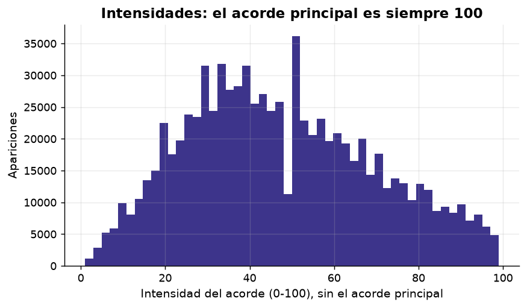

- **Acordes ultra-raros (outliers de vocabulario):** de 92 acordes distintos, **20 aparecen en menos de 50 perfumes** (`tennis ball`, `wet plaster`, `brown scotch tape`, `bbq`…; algunos en 1–5 perfumes). No aportan señal estadística y favorecen el sobreajuste, así que el vocabulario final es de **72 acordes**.

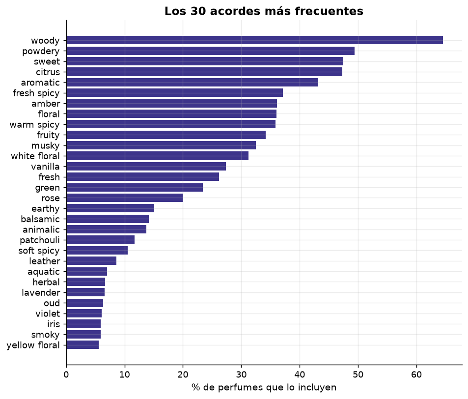

### 2.4 Outliers por votos (confiabilidad de la etiqueta)

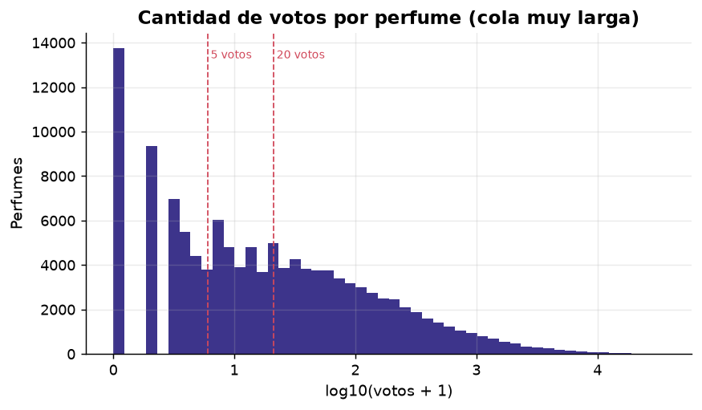

La cantidad de votos tiene cola larga: **mediana 13**, **32,5 % de los perfumes con menos de 5 votos** y 13.764 con 0. Un perfume con pocos votos tiene acordes y género menos confiables. ¿Conviene filtrarlos? Se midió entrenando con distintos mínimos y validando sobre el mismo conjunto:

| Votos mínimos para entrenar | Filas de entrenamiento | F1 macro (validación) |
|---|---|---|
| 0 (todo) | 78.691 | 0,598 |
| 5 | 53.014 | 0,602 |
| 20 | 34.487 | 0,601 |
| 50 | 23.311 | 0,596 |

La mejora es de ~0,3 puntos (dentro del ruido) a costa de **perder 33–70 % de los datos**, así que **no se filtra**. Sí se usa esta información al *evaluar* (ver 3.5): el modelo es menos preciso justamente en los perfumes con pocos votos.

### 2.5 Duplicados y etiquetas contradictorias
Había **6.206 filas con un perfil de acordes idéntico a otro** (típicamente versiones o concentraciones de un mismo perfume) y **727 perfiles con géneros distintos** (5.741 filas). Si no se tratan, el mismo perfil puede quedar en train y en test y el modelo "memoriza" en vez de generalizar. **Decisión:** un registro por perfil; si hay conflicto de etiqueta se conserva la que tiene más respaldo (suma de `vote_count + 1`).

### 2.6 ¿Qué distingue a cada género?

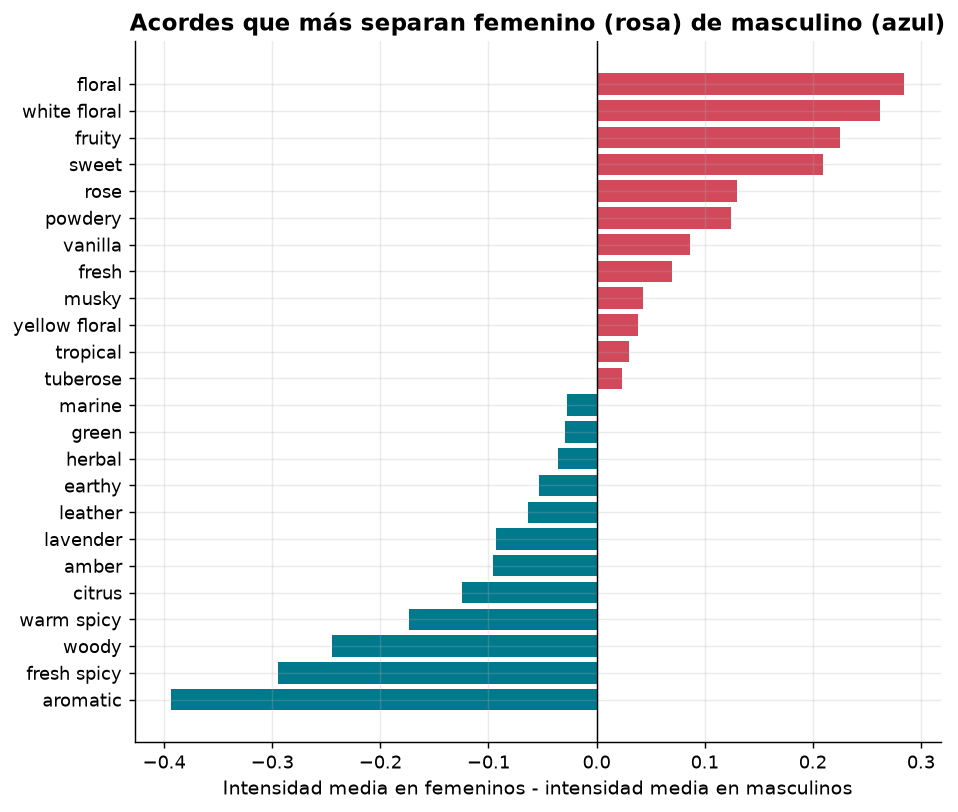

Los femeninos se caracterizan por **floral, white floral, fruity, sweet, rose, powdery y vanilla**; los masculinos por **aromatic, fresh spicy, woody, warm spicy, citrus, amber, lavender y leather**. Hay estructura clara en los datos, y por eso el problema es viable.

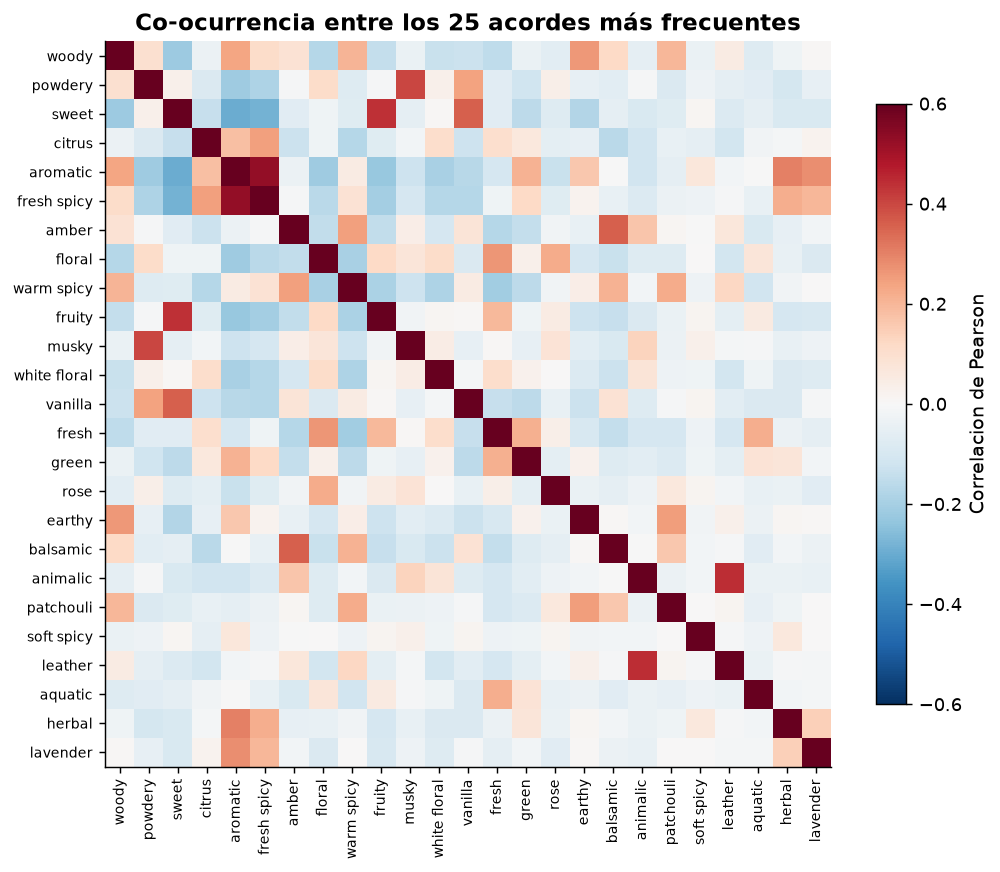

### 2.7 Transformación final
Cada perfume se convierte en un **vector de 72 posiciones** (una por acorde del vocabulario, `models/accords_vocab.json`) con la intensidad/100 o 0 si no está. La API aplica exactamente la misma transformación y, además, **reescala la entrada del usuario para que su acorde más fuerte valga 100**, igual que en los datos.

---

## 3. Selección y entrenamiento del modelo

### 3.1 Protocolo (para no engañarse con la métrica)
- **Test (24.591 perfumes) separado desde el ETL y usado una sola vez**, al final, solo con el modelo ya elegido.
- La **selección de modelo se hace por validación cruzada estratificada de 5 folds sobre el train** (métrica: F1 macro).
- Perfiles idénticos deduplicados antes de partir, para no filtrar información entre train y test.

### 3.2 Experimento de features: acordes vs. notas
Con un modelo rápido y una validación interna:

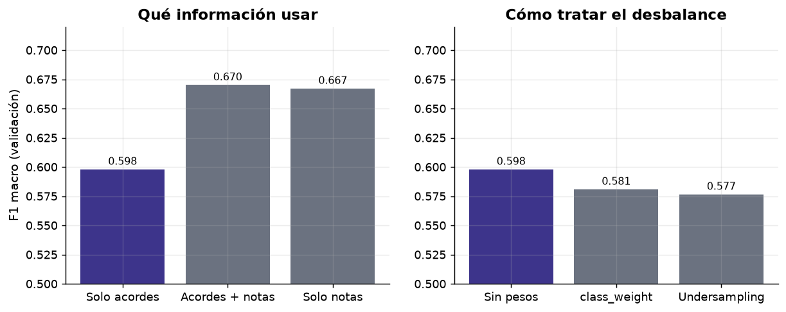

| Variables | F1 macro | Exactitud |
|---|---|---|
| **Solo acordes (elegido por caso de uso)** | 0,598 | 0,644 |
| Acordes + notas (top 300 notas) | 0,670 | 0,701 |
| Solo notas | 0,667 | 0,698 |

Las notas **sí suman** (≈ +7 puntos), pero se asume que no están disponibles en la etapa temprana (ver sección 1). Es el principal camino de mejora si el perfumista ya tiene la pirámide olfativa.

### 3.3 Comparación de modelos (CV, 5 folds, sobre train)

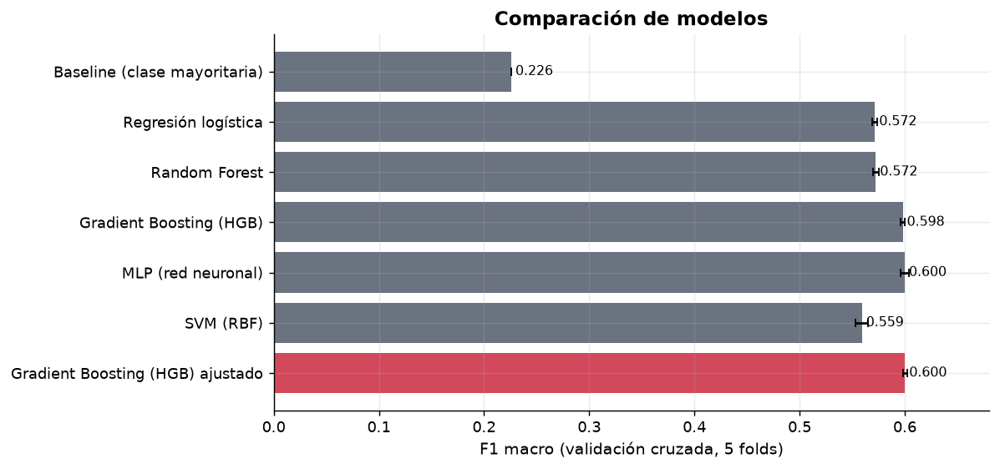

| Modelo | F1 macro (media ± desvío) | Exactitud |
|---|---|---|
| Baseline (clase mayoritaria) | 0,226 | 0,512 |
| Regresión logística | 0,572 ± 0,002 | 0,634 |
| Random Forest | 0,572 ± 0,003 | 0,643 |
| SVM RBF (submuestra de 20.000 filas*) | 0,559 ± 0,006 | 0,633 |
| Gradient Boosting (HGB) | 0,598 ± 0,002 | 0,646 |
| MLP (red neuronal) | 0,600 ± 0,004 | 0,646 |
| **Gradient Boosting (HGB) ajustado** | **0,600 ± 0,002** | **0,647** |

\* La SVM con kernel RBF es O(n²) y no escala a 98 mil filas; además no entrega probabilidades calibradas de forma nativa, por lo que no era candidata a servirse.

**Ganador: Gradient Boosting (`HistGradientBoostingClassifier`) con hiperparámetros ajustados** por `RandomizedSearchCV` (10 combinaciones, 3 folds): `learning_rate=0.08`, `max_leaf_nodes=63`, `min_samples_leaf=20`, `max_iter=300`. El MLP queda técnicamente empatado (la diferencia está dentro del desvío); se prefiere Gradient Boosting porque es más estable entre folds, rápido de entrenar y el artefacto pesa **~1 MB**, por lo que viaja en el repositorio y los perfumistas **no necesitan reentrenar**.

Lectura honesta: los modelos "sofisticados" apenas superan a la regresión logística (≈ +3 puntos de F1). El techo no lo pone el algoritmo sino la **información disponible** (solo acordes) y la ambigüedad propia de la clase *unisex*.

### 3.4 Resultado final en el conjunto de test

| Métrica | Modelo | Baseline |
|---|---|---|
| **Exactitud** | **64,7 %** | 51,2 % |
| **F1 macro** | **0,599** | 0,226 |

| Clase | Precisión | Recall | F1 | Perfumes |
|---|---|---|---|---|
| Femenino | 65,5 % | 66,5 % | 0,660 | 8.187 |
| Masculino | 58,5 % | 36,6 % | 0,451 | 3.811 |
| Unisex | 65,3 % | 72,0 % | 0,685 | 12.593 |

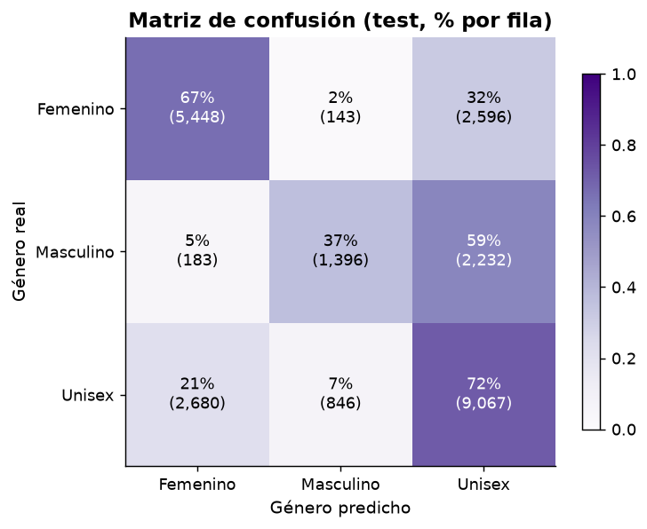

**Cómo leer esto (lo importante para el usuario):**
- El modelo **casi nunca invierte el género**: solo el **2 %** de los femeninos se predicen como masculinos y el **5 %** de los masculinos como femeninos. **Los errores van casi todos hacia "unisex"**, la zona gris. Para el perfumista, un resultado "Femenino" o "Masculino" claro es una señal fuerte; un "Unisex" es una señal de ambigüedad.
- **Los masculinos son la clase más difícil** (recall 37 %): muchos perfiles masculinos son indistinguibles de los unisex por acordes.

### 3.5 Calibración, importancia y robustez

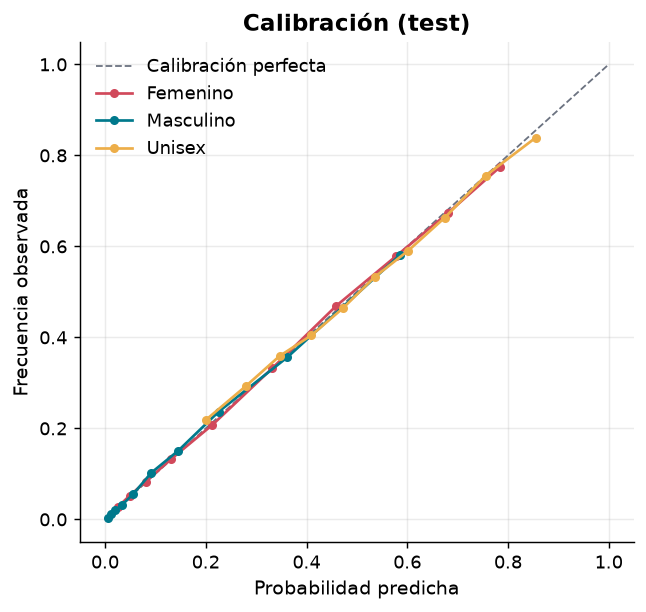

- **Probabilidades bien calibradas** (error de calibración esperado ≈ 0,4 % para femenino y masculino, 1,0 % para unisex): cuando el modelo dice "70 %", ocurre cerca del 70 % de las veces. Por eso la app muestra probabilidades y no solo una etiqueta.

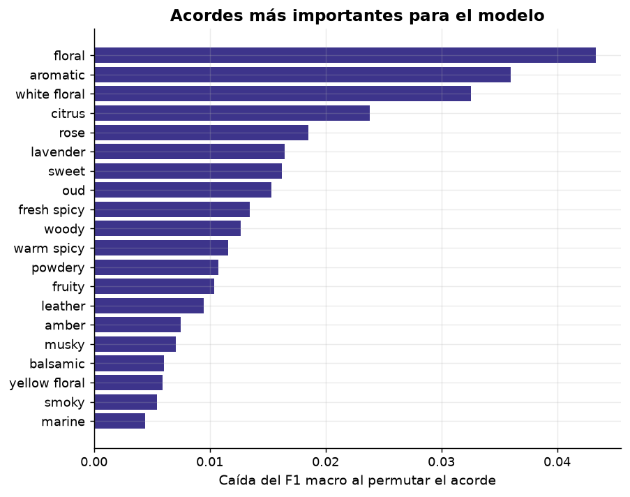

- **Acordes que más mueven la predicción:** `floral`, `aromatic`, `white floral`, `citrus`, `rose`, `lavender`, `sweet`, `oud`.
- **Robustez por marca:** si el test contiene **marcas que el modelo nunca vio**, el F1 macro es **0,598** (vs 0,599 con partición aleatoria): el modelo generaliza a perfumes de marcas nuevas, que es el caso de uso real.
- **Según la cantidad de votos del perfume** (F1 macro): 0–4 votos **0,570** · 5–19 **0,587** · 20–99 **0,624** · 100+ **0,616**. Con perfiles "ruidosos" el rendimiento baja, como era de esperar.

---

## 4. Modelo terminado, demo y uso

### 4.1 Qué se entrega
- **Modelo:** Gradient Boosting (scikit-learn) en `models/model.joblib` (~1 MB) + `models/accords_vocab.json` (72 acordes) + `models/metadata.json`.
- **Backend:** API REST con **FastAPI** (`app/backend`).
- **Frontend:** página estática (HTML/CSS/JS, sin dependencias externas ni CDN: funciona sin internet) servida por el mismo backend (`app/frontend`).
- **Pipeline reproducible** y **tests** (`pipeline/`, `tests/`).

### 4.2 Instalación y ejecución (usar la app)
Requisito: **Python 3.12 o superior** (probado con 3.14).

**Windows:** doble clic en `run.bat`, o desde una terminal:
```bash
run.bat
```
**Linux / Mac:**
```bash
./run.sh
```
La primera vez crea el entorno virtual (`.venv`) e instala `requirements.txt`. Luego abrir **<http://localhost:8000>**. La documentación interactiva de la API queda en <http://localhost:8000/docs>.

Manualmente:
```bash
python -m venv .venv
.venv\Scripts\activate            # Linux/Mac: source .venv/bin/activate
pip install -r requirements.txt
python -m uvicorn app.backend.main:app --port 8000
```

### 4.3 Cómo usar la demo
1. En **Predictor**, buscá y tocá los acordes (hasta 8) o usá uno de los **ejemplos rápidos**.
2. Ajustá la **intensidad** con los controles deslizantes (es relativa: el acorde más fuerte se toma como 100).
3. A la derecha aparece la **tendencia**, las **probabilidades** de cada género y **qué acordes pesan más** (cuánto cambia cada probabilidad si ese acorde se quita).
4. La pestaña **Sobre el modelo** muestra las métricas reales leídas de la API (comparación de modelos, matriz de confusión, experimento de notas).

Ejemplo: *aromatic 100 · fresh spicy 80 · citrus 65 · lavender 50 · woody 40* → **Masculino (69 %)**, unisex 28 %, femenino 3 %.

### 4.4 API
`POST /api/predict`
```bash
curl -X POST http://localhost:8000/api/predict -H "Content-Type: application/json" \
  -d '{"accords":[{"name":"woody","intensity":100},{"name":"fresh spicy","intensity":70},{"name":"aromatic","intensity":55}]}'
```
Respuesta (resumida):
```json
{
  "label": "male",
  "probabilities": {"female": 0.03, "male": 0.69, "unisex": 0.28},
  "accords_used": {"woody": 100.0, "fresh spicy": 70.0, "aromatic": 55.0},
  "influences": [{"accord": "woody", "effect": {"female": -0.05, "male": 0.11, "unisex": -0.06}, "pushes_toward": "male"}]
}
```
| Endpoint | Descripción |
|---|---|
| `GET /api/health` | Estado del servicio y del modelo |
| `GET /api/accords` | Vocabulario de acordes válidos y máximo permitido |
| `POST /api/predict` | Predicción + influencia de cada acorde (valida entradas: acordes desconocidos → 422) |
| `GET /api/model/info` | Metadatos y métricas del modelo (leídos de `models/` y `reports/`) |

### 4.5 Reentrenar desde cero (opcional)
Requiere el dataset en `data/raw/perfumes.csv` (ver `data/raw/README.md`).
```bash
python pipeline/run_all.py
```
Ejecuta en orden: `01_eda.py` (figuras) → `02_etl.py` (limpieza) → `03_experiments.py` (features / desbalance / votos) → `04_train.py` (CV + modelo final) → `05_evaluate.py` (evaluación y figuras). Todas las cifras de este README salen de `reports/*.json`. Semilla fija (`42`): los resultados son reproducibles.

### 4.6 Estructura del repositorio
```
├── README.md
├── requirements.txt            # versiones fijadas
├── run.bat / run.sh            # levantar la app con un comando
├── perfume_gender/             # lógica compartida (parseo, features, predictor)
├── pipeline/                   # EDA → ETL → experimentos → entrenamiento → evaluación
├── app/
│   ├── backend/                # FastAPI
│   └── frontend/               # HTML + CSS + JS
├── models/                     # modelo entrenado, vocabulario y metadata
├── reports/                    # métricas en JSON (fuente de las cifras del README)
├── docs/figures/               # gráficos
├── data/raw/                   # aquí va perfumes.csv (no versionado)
└── tests/                      # pytest
```
Tests: `python -m pytest tests -q`.

### 4.7 Limitaciones y próximos pasos
- Es una **orientación estadística**: se entrenó con acordes votados por usuarios de perfumes ya lanzados, no con fórmulas.
- Exactitud de **64,7 %** (baseline 51,2 %): útil para detectar perfiles claramente femeninos o masculinos; los perfiles intermedios caen en *unisex*.
- **Validar con perfumistas reales** que los acordes sean el dato disponible al hacer el pedido; si conocen las notas, un modelo "acordes + notas" subiría ~7 puntos de F1.
- Ideas: sugerir qué acorde agregar/quitar para mover un perfil hacia un género objetivo; traducir los nombres de acordes al español; modelo alternativo con notas.

---
*Proyecto de Machine Learning. Datos: Fragrantica (vía Kaggle).*
